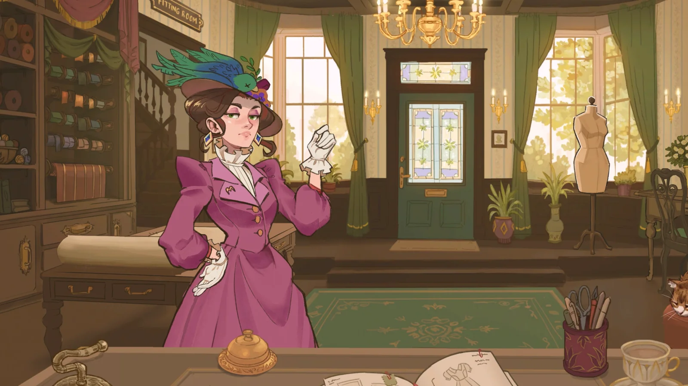
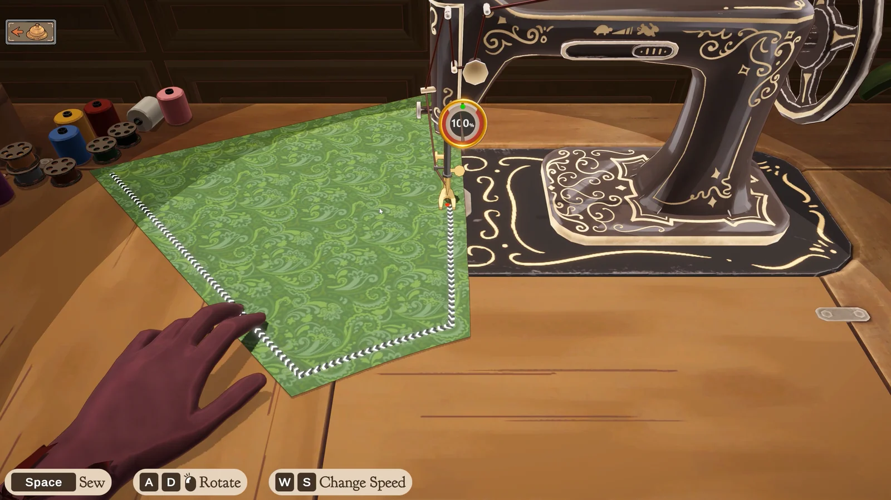

# Dressmaker Game Wiki

Visit [dressmakergamewiki.com](https://dressmakergamewiki.com/) to play Dressmaker in your browser, find the Steam edition, or open a guide for the step you are working on.

## Play with a field guide

[Open the free browser player](https://dressmakergamewiki.com/play/). Choose a step beside the game to see a short explanation. You can open the full guide in another tab and return to your current session.

## Find help with a commission

- [Your first commission](https://dressmakergamewiki.com/guides/first-commission/) follows a dress from the customer's request to delivery.
- [The finish button is missing](https://dressmakergamewiki.com/guides/cannot-finish-dress/) helps you distinguish unfinished assembly from a customer verdict.
- [View the full game on Steam](https://store.steampowered.com/app/4019220/Dressmaker/) for the commercial edition and its platform details.

Dressmaker Game Wiki is an independent guide. Full-edition screenshots are from Cozy Lives / Free Lives.
